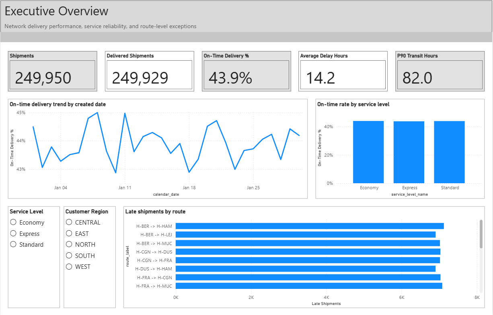
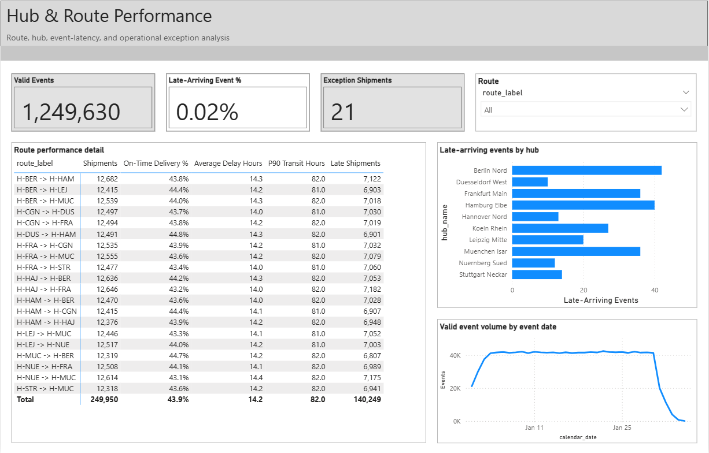
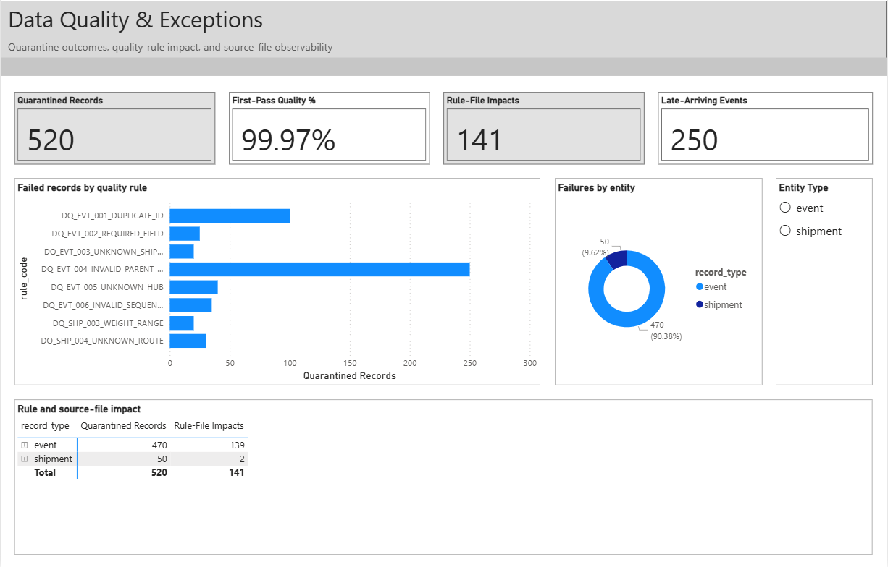

# Supply Chain Operations Analytics Lakehouse

I built this project to explore a practical logistics analytics problem from source data to
reporting: where are delivery promises being missed, which routes and hubs contribute most,
and how much confidence can I place in the underlying data?

The company in this project, Nordlicht Logistics GmbH, is fictional. All shipment and event
records are generated locally with a fixed seed. No real customer, carrier, employee, or
tenant data is used.

## Project overview

The local implementation generates 250,000 shipments and more than 1.25 million shipment
events, introduces a known set of data-quality problems, and processes the data through
bronze, silver, and gold layers.

The pipeline covers:

- deterministic Parquet generation split into daily event batches;
- schema and file-hash validation before ingestion;
- idempotent loads and safe replacement of a previously seen file;
- deduplication, reference checks, lifecycle checks, and quarantine handling;
- late-arriving events that remain valid but are measured separately;
- a dimensional model for shipments, events, dates, hubs, routes, service levels, and quality
  results;
- Python and SQL tests; and
- a three-page Power BI project for operational performance and data-quality analysis.

## Architecture

```text
Synthetic Parquet sources
        |
        v
Bronze + ingestion metadata
        |
        +------> Quarantine and quality results
        v
Silver conformed tables
        |
        v
Gold dimensions and facts
        |
        +------> SQL tests
        +------> Power BI semantic model
```

DuckDB and Parquet provide the local execution path. The `fabric/` directory contains a
PySpark and Delta Lake version for a Fabric Lakehouse. In a local Spark 3.5 container it
reproduces the DuckDB results on all 40 reconciliation checks and passes all 7 SQL
assertions; it has not yet been run in a Fabric workspace.

## Verified local run

The full run completed with the default seed and volume:

| Result | Count |
|---|---:|
| Generated shipments | 250,000 |
| Generated event rows | 1,250,100 |
| Valid silver shipments | 249,950 |
| Valid silver events | 1,249,630 |
| Quarantined rows | 520 |
| Gold shipment rows | 249,950 |
| Gold event rows | 1,249,630 |

Running the pipeline a second time loaded zero files and skipped all 39 unchanged inputs. A
second generation with the same settings produced the same manifest fingerprint:
`8851831e6d37c7f5f734fbeabafc2ccb3801419d43abfcbb53b12a4212196dd7`.

## Run it locally

Python 3.11 is the tested version.

```powershell
python -m venv .venv
.venv\Scripts\python -m pip install -e ".[dev]"
.venv\Scripts\python -m supply_chain_ops generate
.venv\Scripts\python -m supply_chain_ops run
.venv\Scripts\python -m pytest
```

The generated data is intentionally excluded from Git. For a quicker development run, add
`--shipments 1000` to the generation command.

## Power BI

The report source is stored as a Power BI Project (`.pbip`) with a TMDL semantic model. After
the gold tables have been generated, I rebuild and open the local copy with:

```powershell
.\scripts\open_powerbi.ps1
```

The script opens `powerbi/.runtime/SupplyChainOperationsLocal.pbip`. The portable project
under `powerbi/project/` uses typed empty tables until its data-root parameter is configured;
it is intended for source control and inspection, not local data refresh.

The report has three pages:

1. Executive Overview
2. Hub Route Performance
3. Data Quality Exceptions

The local model has refreshed successfully in Power BI Desktop and its headline totals have
been reconciled to DuckDB. I also completed the desktop layout review and saved the final
report canvases without Power BI account or connection details.

### Report pages

#### Executive Overview



#### Hub & Route Performance



#### Data Quality & Exceptions



## Repository layout

- `src/supply_chain_ops/` — generator, ingestion, quality processing, and orchestration
- `sql/` — silver/gold transformations and SQL assertions
- `tests/` — deterministic generation and end-to-end pipeline tests
- `docs/` — architecture, data dictionary, quality rules, KPIs, and run evidence
- `powerbi/` — report generator, semantic model, measures, and page definitions
- `fabric/` — PySpark/Delta notebooks for Fabric, local Spark rehearsal, and run book

More detail is available in the [architecture](docs/architecture.md),
[data dictionary](docs/data-dictionary.md), [quality rules](docs/quality-rules.md), and
[local verification notes](docs/local-verification.md).

## Current limitations

- The Fabric notebooks have passed a local Spark and Delta rehearsal, but the notebooks and
  the Data Factory pipeline have not yet been executed in a Fabric workspace.
- GitHub Actions passes the local-lakehouse CI checks on `main`.
- The local pipeline rebuilds silver and gold from the current bronze snapshot instead of
  incrementally merging every downstream table.
